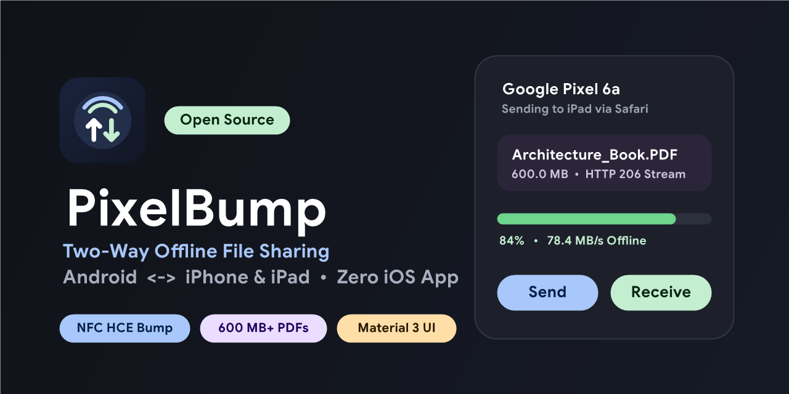

<p align="center">
  
</p>

<h1 align="center">PixelBump</h1>

<p align="center">
  <strong>Zero-install, two-way offline proximity file sharing between Android and iPhone/iPad.</strong>
</p>

<p align="center">
  <a href="https://dailydiscussion.github.io/PixelBump/"></a>
  <a href="https://github.com/dailydiscussion/PixelBump/releases/latest"></a>
  
  <a href="LICENSE"></a>
</p>

Install **PixelBump** only on your Android phone. Recipients on **iPhone or iPad** install nothing—just bump via NFC or scan a QR code with the stock Camera app to send and receive full-resolution files straight through Safari over local Wi-Fi or Hotspot.

---

## Why PixelBump?

| Feature | **PixelBump** | Google Quick Share (Pixel 6–9) | PairDrop / Snapdrop | LocalSend / Xender |
| :--- | :---: | :---: | :---: | :---: |
| **App required on iPhone / iPad?** | **No (Safari only)** | No (cloud QR link) | No (browser) | Yes (both devices) |
| **Works 100% offline (no internet)?** | **Yes** | No (cloud upload) | Needs WAN to load site | Yes |
| **Physical NFC Bump (Android $\rightarrow$ iPhone)?** | **Yes (HCE Type 4)** | No | No | No |
| **Two-way transfer (iOS $\rightarrow$ Android)?** | **Yes (Safari Drop Box)** | One-way only | Yes | Yes |
| **Handles 600 MB+ PDFs without Safari crash?** | **Yes (`HTTP 206` Disk Stream)** | Yes | RAM-limited | Yes (via app) |

---

## Key Features

### 1. Zero-App Apple Receiver & Uploader
* **Pixel $\rightarrow$ Apple (Send):** Share any file from Android's Gallery or Files app straight to PixelBump.
  * **Photos & Videos ($\le$ 100 MB):** Stream directly into Safari with an AirDrop-style **Accept / Decline** modal and 1-tap **Save to Apple Photos** via iOS Web Share API.
  * **Large Files & Documents ($>$ 25 MB docs / $>$ 100 MB media):** Automatically hand off to Safari's native Download Manager (`Content-Type: application/octet-stream`, `Content-Disposition: attachment`) with **HTTP `Range` (`206 Partial Content`)** seeking—so 600 MB+ PDFs save straight to **Apple Files $\rightarrow$ Downloads** without hitting WebKit's in-memory Blob limits.
  * **Live In-Page Progress:** Polls `/progress` to display real-time transfer percentage, `MB/s` speed, and bytes transferred right on the Safari card even during direct disk streaming.
* **Apple $\rightarrow$ Pixel (Receive):** Switch PixelBump to **Receive** to open a Safari Drop Box on iPhone/iPad.
  * Uses the native iOS Photo Library & Files picker (`<input type="file" multiple>`).
  * Shows an expressive **Accept & Save / Decline** bottom sheet on Android before saving directly into **MediaStore** (`Pictures/PixelBump`, `Movies/PixelBump`, `Downloads/PixelBump`) so photos appear straight in Google Photos.

### 2. Physical NFC "Bump" (Host Card Emulation)
* Emulates an **NFC Forum Type 4 Tag** (`NDEF` URI record) in Android HCE (`PixelHceService`), supporting both Type 4 v1.0 (`D2760000850100`) and v2.0 (`D2760000850101`) AIDs.
* Touching the back of a Pixel against the top of an iPhone triggers iOS Background Tag Reading and drops a native notification banner instantly.

### 3. Guided Dual-Mode Pairing & Offline Speed
* **Same Wi-Fi & Hotspot QR:** Supports 1-scan Same Wi-Fi links and 2-step Pixel Hotspot pairing (`WIFI:S:...` Join + Safari link) with smart `ap*`/`wlan*` interface detection that filters out cellular (`rmnet*`) and VPN (`tun*`) interfaces.
* **High-Throughput Locks:** Acquires `WifiManager.WIFI_MODE_FULL_LOW_LATENCY`, `PARTIAL_WAKE_LOCK`, `256 KB` buffers, and `TCP_NODELAY` so Android stays at full Wi-Fi throughput even when mobile data/internet is off.

### 4. Android 17 Material 3 Expressive UI & Security
* Built with Jetpack Compose, solid high-contrast tonal containers, edge-to-edge system bar insets, bundled offline **Google Sans** typography, and adaptive + monochrome launcher icons.
* Hardened with `android:debuggable="false"`, `allowBackup="false"`, `usesCleartextTraffic="false"` (`network_security_config.xml`), 16-char per-file session tokens, and same-origin enforcement.

---

## Live GitHub Pages Demo

A mobile-optimized interactive demo site is included in [`docs/index.html`](docs/index.html). After pushing to GitHub, enable it in **Settings $\rightarrow$ Pages $\rightarrow$ Deploy from a branch $\rightarrow$ `main` / `/docs`**.

---

## Building from Source

### Requirements
* Android Studio / Gradle 9.1+ with JDK 17+
* Android SDK 36 (`minSdk = 26`, `targetSdk = 36`)
* Physical Android device with NFC HCE enabled for NFC bump testing

### Build Release APK
1. Add your keystore properties to `local.properties` (gitignored) or environment variables (`PIXELBUMP_STORE_FILE`, `PIXELBUMP_STORE_PASSWORD`, `PIXELBUMP_KEY_ALIAS`, `PIXELBUMP_KEY_PASSWORD`).
2. Run Gradle:
   ```bash
   ./gradlew assembleRelease
   ```
3. Output APK: `app/build/outputs/apk/release/app-release.apk`

---

## Technical Boundaries
* **Apple Wi-Fi Join Confirmation:** iOS/iPadOS requires user confirmation (`[Join]`) on `WIFI:` QR codes by design to prevent silent network switching.
* **Native AirDrop Button (`AWDL`):** Unrooted Android Wi-Fi drivers do not expose raw `AWDL` monitor/injection frames, so PixelBump bridges via local HTTP + NFC HCE + Safari rather than appearing inside Apple's proprietary `AWDL` peer list.
